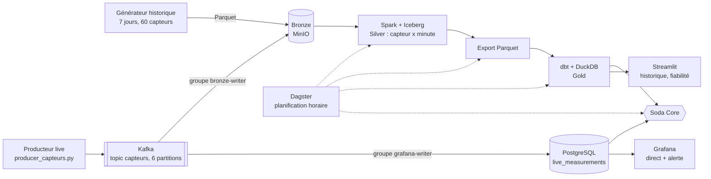

# Plateforme data des serres connectées (Sujet 7 : capteurs IoT)

Projet fil rouge : 15 serres × 4 capteurs (température, humidité de l'air, humidité du sol, CO2) = 60 capteurs,
données synthétiques volontairement imparfaites (manquants, aberrants, doublons, pannes, °F, messages en retard).

**Auteure :** Yousra El Amrani (projet réalisé seule)

## Architecture



Deux chemins : **lots** (historique, Bronze → Silver → Gold, piloté par Dagster) et **flux** (live, Kafka → PostgreSQL → Grafana, en continu).
Tous les horodatages sont en UTC. Détail et justification de chaque outil : voir le rapport.

## Prérequis
Docker Compose v2, Python 3.12, 16 Go de RAM (WSL2 ou Linux).

## Lancement (5 commandes, depuis la racine du dépôt)

```bash
cp .env.example .env     # puis remplacer les valeurs change_me_* dans .env
docker compose up -d     # MinIO, Kafka, Kafka UI, PostgreSQL, Grafana ; attendre ~30 s
python3 -m venv .venv && source .venv/bin/activate && pip install -r requirements.txt
python -m src.generator.ingest_capteurs --end 2026-11-23T00:00:00   # 7 jours d'historique -> Bronze
bash scripts/refresh_chain.sh   # Silver (Spark) -> export -> Gold (dbt) -> contrôles Soda ; 1er lancement : build de l'image Spark
```

> Avant le démarrage du producteur, `refresh_chain.sh` signale des échecs Soda live (aucune donnée temps réel) : c'est attendu, ce contrôle est informatif et ne bloque pas la chaîne.

### Temps réel (3 terminaux, venv activé, depuis la racine)
```bash
python -m src.streaming.producer_capteurs --interval 5                # producteur (ajouter --heat G05 pour une canicule)
python -m src.streaming.bronze_writer                                 # groupe Kafka 1 : -> Bronze (MinIO)
python -m src.streaming.grafana_writer                                # groupe Kafka 2 : -> PostgreSQL (Grafana)
```

### Orchestration et application de présentation
```bash
bash scripts/setup_dagster.sh && bash scripts/run_dagster.sh          # Dagster : http://localhost:3100
streamlit run app/streamlit_app.py                                    # Streamlit : http://localhost:8501
python -m src.ml.isolation_forest                                     # IOT-09 : Isolation Forest vs seuils fixes
```

| Service | Adresse |
|---|---|
| Grafana (dashboard « Serres connectées - direct », alerte) | http://localhost:3000 |
| Kafka UI (groupes de consommateurs) | http://localhost:8085 |
| Dagster | http://localhost:3100 |
| Streamlit | http://localhost:8501 |
| Console MinIO | http://localhost:9001 |

## Données et couches
- **Bronze** (MinIO) : `bronze/historique/capteurs/event_date=.../` et `bronze/live/capteurs/event_date=.../` (Parquet brut, jamais modifié).
- **Silver** (Iceberg) : `lake.silver.measurements_1min` (grain : un capteur sur une minute, °C/%/ppm), `measurements_rejected`, `etl_state`.
- **Gold** (dbt + DuckDB) : `gold_greenhouse_5min`, `gold_greenhouse_1h`, `gold_sensor_availability`, `gold_alert_periods`, `gold_sensor_quality`, `dim_sensor` (grains documentés dans `dbt/models/gold/*.yml`).

## Qualité et tests
- `cd dbt && set -a && source ../.env && set +a && dbt build --profiles-dir .` : modèles Gold et tests de données.
- Soda : `soda scan -d silver -c soda/configuration.yml soda/checks_silver.yml` (et `live`).
- `python -m pytest -q` : tests unitaires. GitHub Actions les exécute à chaque push (`.github/workflows/ci.yml`).
- `bash scripts/validate_all.sh` : liste de contrôle de toute la plateforme (preuves dans `docs/preuves/`).

## Limites connues
Kafka sans volume (messages non consommés perdus si le conteneur est supprimé) ; petits fichiers Bronze live non compactés ;
recalcul incrémental du Gold limité aux 2 dernières heures ; dépendance à l'export Parquet Silver ; version DuckDB figée (< 1.1.0, imposée par soda-core-duckdb).

## Couverture du cahier des charges
Voir `docs/COUVERTURE.md` (chaque exigence OBL et OPT avec son statut et sa preuve).
